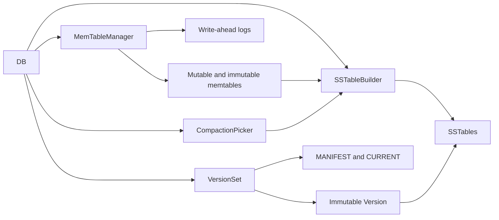

# Architecture

This is a C++23, single-process LSM storage engine for byte-string keys and values. The public `DB<Key, Value>` API provides `open`, `put`, `del`, point `get`, and registered snapshot handles. It flushes memory to level 0 and compacts sorted tables through level 6.

## Component map

| Area | Responsibility |
| --- | --- |
| `src/db` | Coordinates opening, writes, reads, background flushes and compactions, recovery, file naming, and cleanup. |
| `src/memtable` | Stores versioned entries in an arena-backed skip list; rotates one mutable table into at most one immutable table. |
| `src/wal` | Frames and checksums logical records in 32 KiB blocks. The same framing carries write entries and manifest edits. |
| `src/sstable` | Writes immutable sorted tables and reads them through an in-memory block index. |
| `src/version` | Chooses compaction inputs, records file-set changes, publishes immutable versions, and persists the current file set in a manifest. |
| `src/iterator` | Adapts memory and disk cursors, concatenates disjoint files in a level, and merges sorted inputs. |
| `src/coding.h`, `src/key.h`, `src/util` | Define byte encodings, internal-key order, and shared POSIX file operations. |

`src/deprecated` contains the older heap-allocated memtable and skip list used by the memory benchmark. They are outside the live DB path.

## Data model and reads

An internal key is a user key plus a packed sequence number and value type. Entries sort by user key ascending and packed tag descending, placing newer versions first. A delete is a tombstone. A lookup must distinguish a tombstone from a miss so it can stop before an older value resurfaces.

`DB::get` searches the mutable and immutable memtables, then a captured `Version`. Level-0 tables can overlap and are searched newest file first. Levels 1–6 are disjoint, key-ordered runs, so a lookup selects at most one table in each level. `VersionBuilder` validates this invariant and checks table metadata before publishing an edit.

`DB::snapshot()` returns a move-only handle registered with that DB instance. `get(key, snapshot)` reads at its sequence; `get(key)` registers a short-lived handle for the read. A released handle or a handle from another DB instance is rejected. The handle keeps the sequence active, rather than pinning a specific `Version`, and cannot be used after reopening the DB. Arbitrary raw sequence-number reads are not part of the public DB API.

Each SSTable contains sorted data blocks, an index entry for the last internal key in each block, and a fixed footer pointing to the index. Data and index blocks have CRC-32 trailers. Opening a table reads its footer, index, and first data block; later data blocks are read on demand, without a block cache. Iterators return views into their current storage, so callers must use them before advancing.

## Write, flush, and recovery

1. `DB` serializes sequence assignment through WAL append and memtable insertion. `MemTableManager` appends the encoded write to the current WAL before inserting it into the mutable memtable. Snapshot registration takes the same write lock to capture a completed prefix.
2. When the memory threshold is reached, the manager rotates to a new mutable table and log. It permits one immutable table awaiting flush.
3. A background worker copies the frozen table, in internal-key order, to a new SSTable. It commits the table's metadata and the new log number through `VersionSet`, then releases the immutable table. Failed flushes are retried up to three times and leave the immutable table available for a later retry.
4. A second worker picks an over-budget level and merges its selected tables with every overlapping table in the next level. Level 0 contributes all its files; deeper levels rotate the starting file. Input ranges expand across both levels until every touching file is included. The oldest active snapshot sets the reclamation cutoff, or the completed write sequence when none is active. For each key, the merge retains versions newer than the cutoff and the first version at or below it. It drops that first version too if it is a tombstone and no deeper file can contain the key. Outputs split at a target size only between user keys, preserving disjoint destination ranges. One manifest edit swaps all inputs for the synced outputs.
5. On open, `CURRENT` identifies the manifest. `VersionSet` replays its `VersionEdit` records to rebuild the file set and counters. The DB sweeps crash leftovers, replays eligible WALs, flushes recovered entries, creates a new log, and schedules compaction if a level is over budget.

The manifest is itself a WAL of tagged `VersionEdit` payloads. An edit records added and deleted files, the active log number, the next file number, and the last sequence number. `VersionSet` builds the next immutable `Version` before logging an edit, syncs the manifest, and then publishes the version. When the manifest passes its size limit, it writes a snapshot into a new manifest and atomically replaces `CURRENT`. Recovery also rotates the manifest so subsequent edits start on a clean record stream after a torn tail.

All database files live in one directory. `CURRENT` names a `MANIFEST-<number>` file; `<number>.log` holds writes and `<number>.sst` holds a table. File numbers are allocated from one counter. New SSTables are created exclusively. Cleanup uses live `Version` references and pending output numbers for tables, the active log number for logs, and `CURRENT` for the manifest. Unrecognized directory entries are ignored.

## Concurrency and durability decisions

- Memtable insertion takes an exclusive lock and lookup takes a shared lock on the same mutex; the arena also supports concurrent allocations. Manager pointer swaps use a separate shared mutex. The WAL writer serializes complete logical records.
- A reader captures table pointers before lookup and captures the current immutable `Version` after searching memory. Publishing a flushed version before dropping its immutable memtable keeps the key visible during that transition.
- Existing readers can retain older `Version` objects. `VersionSet::liveFiles` includes their files when cleanup decides what may be removed.
- The flush and compaction workers build outputs outside the manifest lock. Pending output numbers keep a concurrent sweep from removing their files before the manifest commit. A manifest append or sync failure stops further commits until recovery, because the persisted tail may contain an edit that was not published in memory.
- Compaction retries transient failures up to three times. `waitForPendingCompaction()`, `lastCompactionError()`, and `compactionStats()` expose worker state and cumulative input bytes, output bytes, selected input files, elapsed time, and runs by source level.
- Manifest edits and finished SSTables are synced before publication. Ordinary `put` and `del` calls append to a WAL but do not sync it per operation. A process restart can replay WAL bytes that reached storage; recent acknowledged writes are not guaranteed to survive a crash or power loss.
- The file utilities use POSIX operations and Boost CRC and mutex facilities. On macOS, `syncFile` uses `fsync`; directory sync is best effort. The current durability contract should therefore be treated as process-crash recovery, not a verified power-loss guarantee.

## Current boundaries and audit observations

- [COMPACTION_PLAN.md](COMPACTION_PLAN.md) records the staged compaction design. Reclamation happens when an eligible compaction rewrites a key; releasing a snapshot does not immediately rewrite files. A tombstone may remain when a deeper file's key range could contain an older value.
- Recovery builds one memtable from all eligible WALs before making a table. Its memory use is not capped by the normal flush threshold.
- WAL recovery discovers logs by scanning numbered `.log` files at or above the manifest's active log number. The manifest does not enumerate each log, so a stray valid log in that range can be replayed as database data.
- There is no interprocess directory lock. Two DB instances opening the same directory can allocate conflicting file numbers and write concurrently.
- WAL recovery mode stops at the first damaged record and accepts the preceding prefix. It does not distinguish a torn tail from corruption in the middle of a file. A damaged manifest can therefore hide later valid edits in that manifest.
- A failed manifest append can leave a partial record in the active manifest. `logAndApply` blocks later commits until recovery; an uncertain output remains on disk so a complete record that reached storage can still be replayed.
- The packed tag reserves 56 bits for the sequence number; sequence exhaustion is not checked. The WAL fragment header is written as a packed native struct, so its numeric fields assume the writer and reader share byte order.
- The DB exposes point reads and registered snapshots, but no public range scan or compaction API. The build uses `make test` for assertion-based component and end-to-end tests; `make memtable_benchmark` runs the separate arena comparison.
